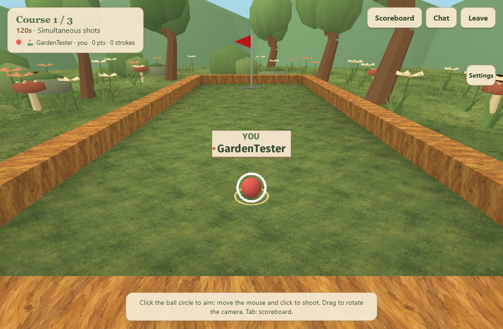
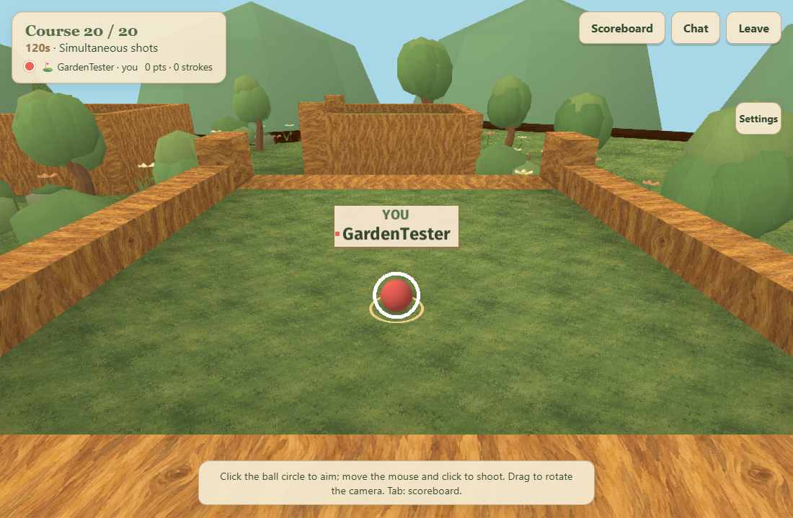

# PitPom Minigolfe — jardim ilustrado

## Diagnóstico e execução

A implementação mantém C, Sokol, Emscripten e o servidor Node/WebSocket.
O diagnóstico e o plano foram apresentados antes das alterações. A sequência
foi: materiais/luz, ambiente natural, mascotes, bola/mira, interface e validação.

| Sistema existente | Local | Tratamento |
| --- | --- | --- |
| Passes 3D, bola, mira, água e UI | `src/golf/draw.c` | Integração de cenário exclusivamente visual |
| Materiais e shaders | `data/shaders`, `src/common/data.c` | GLSL GL330/GLES300 e pipelines Sokol |
| Texturas | `data/textures` | Duas texturas pintadas reutilizadas |
| Modelos e campos | `data/models`, `data/levels` | Conteúdo original preservado |
| Lightmaps, UVs e sombras | arquivos dos campos, lightmapper/xatlas | Lightmaps existentes, luz quente e neblina leve |
| Menus solo e nicknames | `src/golf/ui.c`, `data/ui/ui.ui` | Papel, madeira, texto escuro e cinco níveis de força |
| Lobby/HUD/chat/configurações | `build/emscripten/multiplayer.*` | Interface responsiva em creme/musgo/dourado |
| Física, salas e sincronização | `src/golf/physics.c`, `server/native`, `server/src/room.ts` | Sem alterações |

## Ambiente e feedback

`src/golf/garden.c/.h` gera uma malha decorativa por campo. As árvores desenhadas
têm troncos curvos, galhos e copas arredondadas assimétricas. Flores, arbustos,
cogumelos, tufos de grama, pedras com musgo e uma placa com retratos de Pit e Pom
ficam fora das superfícies de jogo, usando limites conservadores dos triângulos
existentes. Colinas e nuvens compõem o fundo. Folhagem oscila no shader; poucas
borboletas e folhas usam um buffer dinâmico local. Nenhum desses elementos
participa da física ou gera mensagens de rede.

O gramado perde o quadriculado e recebe pinceladas e manchas suaves. A madeira
usa veios pintados. Os lightmaps continuam ativos, com luz ambiente mais suave,
tonalidade de fim de tarde e profundidade atmosférica. A bola mantém raio, cor,
trajetória e orientação; recebe luz suave, sombra discreta e aro dourado local.
Nicknames usam pequenas placas claras. A mira continua com cinco setas e potência
contínua, acompanhada de cinco marcas visuais.

A interface usa Georgia nos títulos e fontes legíveis nos controles, papel creme,
bordas em madeira e acentos de musgo. Campos de texto, IDs DOM, lógica de eventos,
idiomas, chat, música e controles de toque permanecem operacionais. A posição de
configurações continua reservando o espaço do botão de pausa.

## Assets e compilação

- `data/textures/garden/meadow.png`: textura de gramado pintada, 1254 × 1254.
- `data/textures/garden/cedar.png`: textura de cedro envelhecido, 1254 × 1254.
- `data/shaders/garden.glsl`: luz, vento e pinceladas da vegetação.
- `build/generate-visual-shaders.py`: gera fontes GL330/GLES300 e reflexão std140
  juntas para os cinco shaders visuais. É um conversor do subconjunto usado pelo
  jogo, não um compilador GLSL geral. CMake o executa antes do empacotamento.
- `build/emscripten/art/pit-and-pom.png`: ilustração de 1774 × 887 gerada a partir
  da referência enviada pelo usuário, preservando poses, marcas e composição.
  **Pituca/Pit é a cachorra preta e branca**, de pelo curto, orelhas caídas,
  focinho branco e peito salpicado. **Pompom/Pom é a gata laranja e branca**,
  com orelhas laranjas e olhos dourados. A arte aparece inteira no início;
  os retratos da placa do cenário seguem a mesma identidade. Trata-se de uma
  versão derivada da referência, não de uma cópia binária do arquivo original.

As texturas foram geradas com o recurso integrado de imagens, seguindo a skill
`imagegen`, e copiadas sem processamento para o projeto. Os prompts completos
estão em `docs/garden-assets.json`. A ilustração é servida separadamente do
WebAssembly e acrescenta cerca de 3 MB ao primeiro acesso. CMake e Docker copiam
a pasta `art`; o navegador valida seu carregamento em desktop e celular.
O servidor acrescenta MIME types de imagens; o protocolo multiplayer não muda.

```sh
python build/multiplayer.py build
python build/verify-gameplay-assets.py
python build/generate-visual-shaders.py --check
cd server
node test/visual-shaders.mjs
node test/garden-render.mjs
```

## Preservação e validação

`tests/fixtures/gameplay-before-garden.json` registra 706 arquivos originais:
campos, modelos, física C, jogadores, sincronização e regras das salas. A
verificação SHA-256 ignora somente a diferença CRLF/LF nos formatos de texto
explicitamente listados. Os demais bytes devem permanecer idênticos.

Validação local realizada:

- build WebAssembly e TypeScript;
- 11 testes do servidor: protocolo, 20 campos originais, 50 bolas, chat,
  reconexão, identidades e traduções;
- 21 testes de física C, incluindo captura do buraco nos 20 campos;
- 3 testes C: ciclo de jogadores, disposição de labels e idiomas/UTF-8;
- compilação e ligação dos cinco shaders em WebGL2 real;
- renderização dos 20 campos com limite de 72.000 vértices decorativos;
- cinco clientes WebGL, sala com 50 jogadores, tacadas, placar, resize e reconexão;
- fluxo solo: seleção, tacada, pausa, retry, resume e saída;
- edição de nickname pelo teclado, códigos de sala e preferência salva;
- dois contextos móveis: toque, cancelamento, segundo dedo e orientação;
- chat, texto literal seguro, histórico, música audível, volume/mute;
- três idiomas, acentos, pluralização, sala com idiomas diferentes e troca ao vivo.

O workflow Linux compila o contêiner completo, testa física/protocolo e acrescenta
as verificações de integridade dos campos e de shaders WebGL2.

## Desempenho e limites

O cenário é cacheado e enviado à GPU por campo, com até 72.000 vértices
(2,88 MB), mais dois buffers de até 4.096 vértices cada (~328 KB). O buffer CPU
do cenário é liberado após o upload. O orçamento respeita esse limite e mantém
árvores originais visíveis quando não há espaço para substituí-las. São até três
draw calls novas para cenário, sombras e efeitos; substituições e placas de
nickname reduzem chamadas existentes. Duas texturas RGBA adicionam cerca de
12,6 MB antes de eventual overhead/mipmaps. A memória inicial do WebAssembly
permanece 128 MiB.

Os números medidos e os tamanhos dos downloads estão em
`docs/garden-performance.json`. A medição usa Chrome headless/SwiftShader na VM,
com uma página WebGL e 49 clientes WebSocket. É um comparativo sintético limitado
pelo refresh de aproximadamente 60 Hz, sem estimar FPS de celulares físicos.

| Medida (50 jogadores) | Antes | Jardim |
| --- | --- | --- |
| Tempo médio de quadro | 16,62 ms | 16,64 ms |
| Percentil 95 | 16,77 ms | 16,73 ms |
| Draw calls por quadro | 262 | 222 |
| WebAssembly comprimido | 17,96 MB | 23,32 MB |




Limitações: os lightmaps conservam as sombras dos modelos originais; não houve
novo bake completo. Copas visuais e colisores antigos são independentes. A
iluminação é artística, sem novo sistema de sombras dinâmicas ou pós-processamento
pesado. iOS/Android físicos precisam de inspeção manual. Compressão dos assets,
LOD e um novo bake de luz podem reduzir download e melhorar a aparência futura.
O link público e o estado Live do Render precisam ser conferidos no serviço
real depois da promoção de staging.
